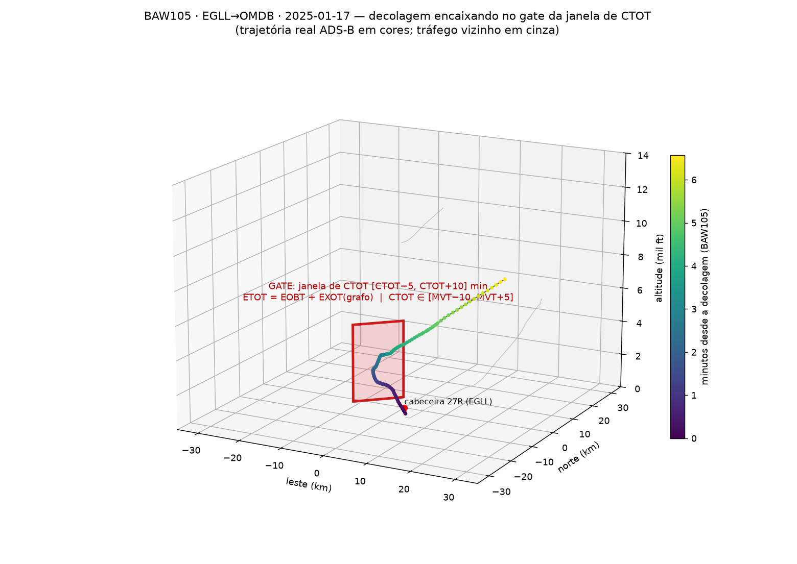
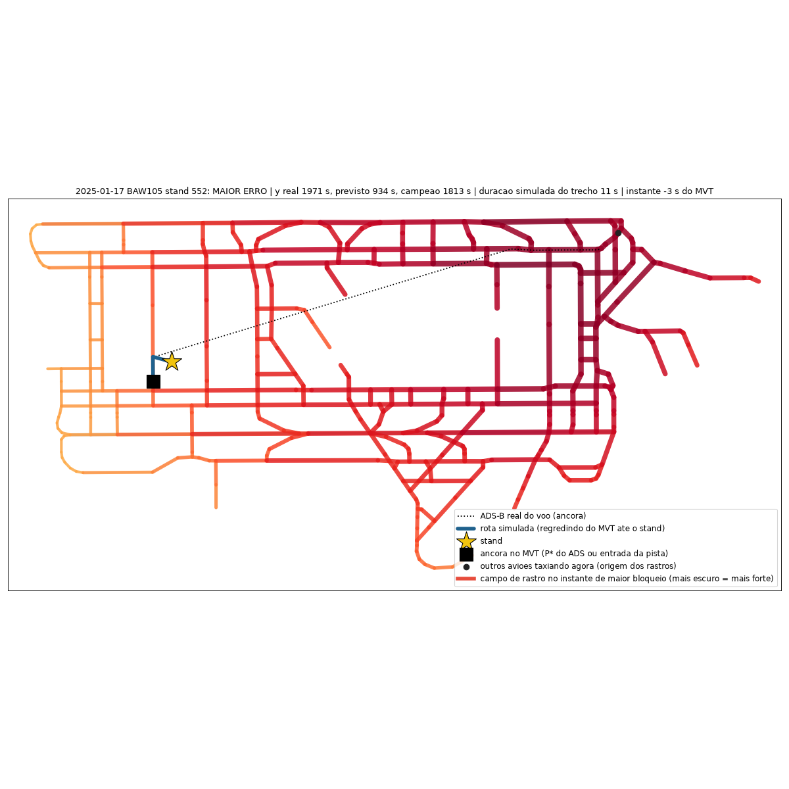
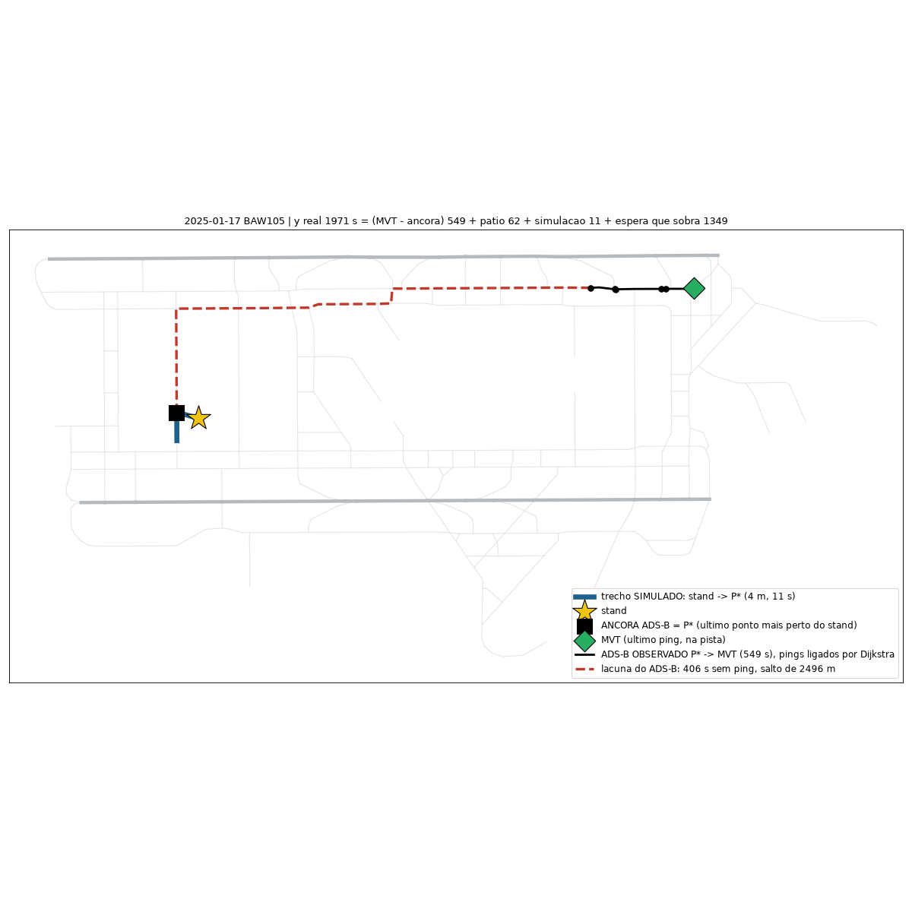
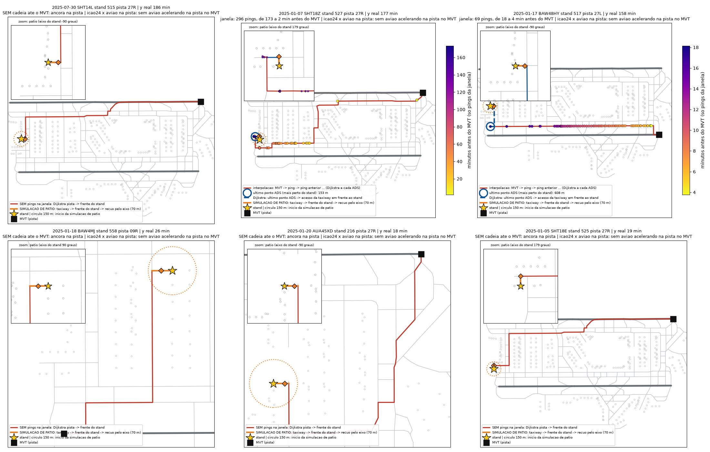
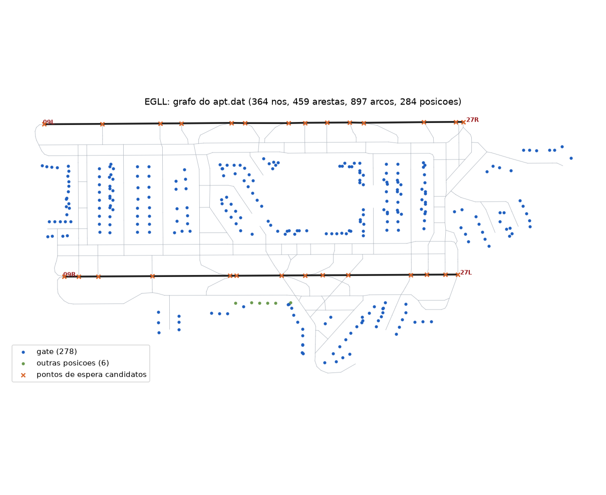

# In development: reconstructing the CTOT slot window with the airport graph as reference

Status: research branch (`feature/in_dev`). The pipeline code of `main` is unchanged; everything here is additional, local-path research code
(see *Reproducibility* below). Two correctors on top of the champion come from this work.

## Idea

Part of the taxi-out error is time spent at the stand that the clocks (EOBT, SOBT, AOBT) do not explain. In the European network a regulated
departure holds at the stand until the slot issued by the Network Manager (CASA) opens: the flight must take off inside a tolerance window of
**−5/+10 min around its CTOT**. A flight that cannot make the window (late TOBT/EOBT, or a taxi longer than the standard) loses the slot and
receives the next free one. The hold is therefore a function of (1) when the flight could first leave, (2) how long its taxi really takes and
(3) when the runway has a free window. None of these is observed directly, so we reconstruct them:

1. **EXOT from the airport graph.** `ETOT = EOBT + EXOT`, `TTOT = TSAT + EXOT` (A-CDM). EXOT is estimated from the taxiway/stand graph
   (Dijkstra path length, turns, crossings, stand level, access distance), airport, runway and wake category with a quantile (α = 0.15)
   gradient-boosting model (out-of-fold by day: correlation 0.70 with the observed taxi, median 841 s). The graph itself and its physical
   simulation (`code/graph_sim/`) are the reference; the simulated graph supplies the unimpeded taxi.
2. **The window, relative to what is observed.** The take-off time MVT is known, so CTOT ∈ [MVT − 10 min, MVT + 5 min].
3. **A runway timeline from ADS-B and movements.** Per airport × runway every departure and arrival (exact MVT) is placed on a timeline. A time `t`
   is *closed* if another movement lies within `b` of it (`b_dep` ≈ 50 s, `b_arr` ≤ 120 s), with `b` **calibrated per runway so that ≥ 90 % of the real
   departures fall in an open window** (91.0 % in 2025, 91.7 % in 2026 with the same `b`).
4. **Look-back from the MVT.** Stepping back minute by minute, at time `s` the flight *could be inside a CTOT window* iff `ETOT ≤ s + 5 min`
   (some slot `c ∈ [s − 10, s + 5]` with `c ≥ ETOT` exists). A **window is available** if that holds and the runway is open at `s`; **blocked** if it holds and
   the runway is closed. Each window lost while the flight was ready (ready, runway open, did not depart) is counted (`n_lost`) and priced at 7 min.
5. **Per-airport weights.** The price of a lost window, of a blocked minute and of the EOBT-anchored wait is fitted **per airport** against the
   stand hold `AOBT − BLOCK` (a target the features do not determine; see *Lessons*).
6. **The proxy of the paper.** As a stand-in for the ATFM demand/capacity signal, we replicate the dynamic indicators of Mas-Pujol & Delgado
   (airport and network demand, normalised by the mean and the maximum of the neighbouring 30 days at the same hour; "fullest crossed sector") with a
   1°×15-min ADS-B occupancy grid of Europe along the great-circle route (`code/paper_proxy/`). It is used both as a baseline and as the reference for what a
   proxy of the regulation can give.

## Reference

- Mas-Pujol, S., & Delgado, L. (2024). *Prediction of ATFM impact for individual flights: A machine learning approach.* Expert Systems with Applications, 252.
  https://www.sciencedirect.com/science/article/pii/S0957417424010121 (open version: https://westminsterresearch.westminster.ac.uk/item/w9y02/prediction-of-atfm-impact-for-individual-flights-a-machine-learning-approach).
  We use their construction of the dynamic features (normalised occupancy/entry counts of the crossed sectors, airport demand, weather) and their conclusion that
  the estimated time of entry into the congested region is what the model lacks.
- EUROCONTROL, *ATFCM Users Manual* ed. 22.1: slot tolerance window (−5/+10 min), ETOT = EOBT + taxi, SRM/SLC re-slotting, TTOT/TSAT/EXOT in A-CDM.
- Capacity as a quantile envelope conditioned on weather: Ramanujam & Balakrishnan (MIT) and the capacity-envelope literature (see the notes of the authors for the list).

## Plots

| | |
|---|---|
|  | **BAW105, EGLL 27R → OMDB, 2025-01-17.** Real ADS-B climb-out (colour = minutes since take-off) crossing the CTOT-window gate; grey = neighbouring traffic. The gate stands for the slot window `[CTOT − 5, CTOT + 10]` min. |
|  | **Simulated EGLL graph, largest-error flight of the day** (BAW105, stand 552, 2025-01-17; observed `y` = 1971 s, graph simulation 934 s, champion 1813 s). Edges are coloured by the strength of the block field made by the other aircraft taxiing at that instant (darker = stronger); blue = route simulated backwards from the MVT to the stand; dotted = the real ADS-B anchor. |
|  | **Decomposition of the same flight**: `y` = 1971 s = (MVT − ADS-B anchor) 549 s + apron 62 s + simulated stand→anchor 11 s + **remaining wait 1349 s**; the red dashed part is an ADS-B gap (406 s without ping, a 2.5 km jump). The remaining wait is the hold that the graph movement does not explain. |
|  | **Six EGLL flights with long `y`** (18–186 min): the window of ADS-B pings regressed from the MVT along the graph (Dijkstra between pings, colour = minutes before the MVT) and the apron simulation at the stand. |
|  | **EGLL taxiway graph** used as the reference for EXOT. |

## Results (measured; out-of-fold protocol of the project: train on ten months of 2025, hold-out January + July, 342,930 departures, residual of the champion, 90 % bootstrap CI over days)

| Step | Δ RMSE (s), dose 0.25 | dose 0.5 |
|---|---|---|
| all earlier groups vs clocks only | −1.109 [−1.474; −0.774] | −1.125 [−1.843; −0.452] |
| runway windows (`Janela_ref`) vs earlier groups | −0.130 [−0.216; −0.051] | −0.158 [−0.382; +0.047] |
| **CTOT window** (`CTOT_janela`: EXOT from the graph, window scan, lost windows) vs earlier groups | **−0.172 [−0.265; −0.084]** | **−0.281 [−0.505; −0.074]** |
| **per-airport hold weights** on top of the runway-window set | **−0.198 [−0.294; −0.104]** | **−0.374 [−0.573; −0.170]** |

For the long-wait flights (AOBT − BLOCK > 10 min, 4.3 % of the hold-out, champion RMSE 625 s against 179 s for the rest) the corrector gains ~15–17 s at dose 0.5 and loses ~2.3 s on the others;
the differences between configurations on that subset are 1–2 s.

## What did not work (also measured)

- Sky occupancy on a 1° grid along the great-circle route (the paper's network indicator replicated with ADS-B): AUC ≈ 0.51 for the stand hold; per-flight signal absent in the residual.
- Sky proximity to other aircraft after take-off (origin, ±min displacement): flat in the displacement, no correlation with the waiting time; windows built from a median template path are spurious (54–73 % "closed" at d = 0).
- Normalising the indicator per runway × direction × hour × weekday into a 0.1–0.9 weight, two/three/five windows, larger minutes (10–30), doubled amplitude: no robust gain over `CTOT_janela`.
- Larger weights or larger **dose** in the tails: the corrector is over-confident exactly there (optimal dose ≈ 0.12 in the centre, ≈ 0.3 above the 99th percentile); a dose of 0.75 in the tail adds +2.4 s to the total RMSE.

## Lessons / caveats

- With `ETOT = AOBT + EXOT`, the minutes "ready" equal `ma − EXOT`, so any weight fitted against the observed taxi is a tautology (R² 0.95–0.99 and equal weights across airports). Only a target the features do not determine (the stand hold `AOBT − BLOCK`) is valid.
- The runway windows are an occupancy proxy, not the real slot: the CTOT itself is not observed. The hold probably also comes from slot constraints that ADS-B cannot show.
- `BLOCK` and `AOBT` are unreliable at some airports (London); the long-wait subset uses them for evaluation only, never as features.
- Gains are small (≤ 0.4 s of RMSE in the out-of-fold protocol).

## Reproducibility

`code/` is research code with absolute local and cloud paths (this machine, a Vertex/GCE instance); no data is included (`data/`, `*.parquet` stay ignored). Layout:

- `code/tracks/` streaming extraction of the ADS-B surface/sky of 10 airports × 365 days of 2025 (adsb.lol `globe_history`; no raw archive kept).
- `code/windows/` runway timelines, calibration (≥ 90 % of departures in open windows), per-flight window features, METAR synchronisation (time interpolation, QNH-corrected altitude, wind relative to the runway), the 3D plot.
- `code/ctot/` EXOT from the graph, the look-back scan, per-airport weights, tables for 2026 and the candidate builders (`make_candidate*.py`). `ctot_apt_tautological.py` is the first (invalid) per-airport fit, kept for the record.
- `code/ablation/` the ablation scripts (same protocol as the project) and `code/paper_proxy/` the replication of the paper's indicators.
- `code/graph_sim/` the airport-graph physical simulation and its diagnostic plots.
- `results/` ablation logs and the per-runway calibration table (`rwy_calib.csv`).
